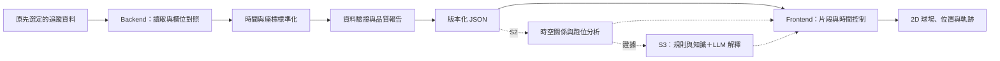

# 系統架構與分工

狀態：實作提案，尚未建立下列功能模組。需求依據見 [簡報整理](requirements.md)，
資料介面草案見 [data-contract.md](data-contract.md)。

## S1 的開發方式

建議採用單一 repository：Python Backend 讀取原先選定資料集，整理並匯出 JSON；
Frontend 載入同一份 JSON，負責球場呈現與時間互動。S1 先以本機靜態展示串接，
後續有動態查詢或上傳需求時再加入 API server。



採檔案介面的原因是讓兩人可先用固定格式各自開發，展示不必依賴資料庫、模型服務或外部 API。
檔案規格與傳輸方式分開：若組員已有 React、Vue 或 API 架構，可保留相同 JSON 定義，
另行確認載入方式。這項建議不代表前端技術已經定案。

## 技術與目錄規劃

| 範圍 | 建議 | 現況 |
| --- | --- | --- |
| Backend | Python 3.12、pandas、NumPy；使用 pathlib 處理路徑 | 已安裝，尚無功能 |
| Frontend | HTML、CSS、JavaScript 模組與 Canvas 2D | 待組員確認，尚未建立 |
| 資料交換 | UTF-8 JSON，顯式版本、單位、時間與來源資訊 | 草案 0.1.0 |
| 本機展示 | Python 標準庫的靜態 HTTP server | 規劃中 |
| 分析／LLM | S2／S3 才追加必要工具 | 尚未選型或安裝 |

Canvas 可繪製 2D 圖形，適合這個初期球場與軌跡畫面，參考
[Canvas API](https://developer.mozilla.org/en-US/docs/Web/API/Canvas_API)。
下列目錄按工作包逐步增加，不先建立空模組：

```text
src/basketball_tactics/
├── data_io/             # 選定資料集的讀取與匯出
├── preprocessing/       # 時間、座標、ID 對照與品質驗證
├── cli.py               # 本機匯出與展示資料準備入口
├── analysis/            # S2 才建立
└── explanation/         # S3 才建立
frontend/
├── index.html
├── styles.css
└── src/                 # 資料載入、球場繪圖、播放控制
tests/
├── fixtures/            # 授權允許的小型樣本或明確標示的合成案例
└── ...                  # 各工作包的測試
outputs/demo/            # 匯出的展示資料與網頁資源；不進 Git
```

僅支援原先選定資料集的第一個 importer，不先設計多資料集插件系統。
資料集確定後再決定欄位映射與原始資料讀取格式。

## Backend／Frontend 責任

| 工作 | Backend：資料處理與戰術分析 | Frontend：視覺化與互動 | 共同確認 |
| --- | --- | --- | --- |
| 資料接入 | 來源盤點、讀取、原始 ID 保留、片段切分 | 顯示片段名稱與資料狀態 | 資料版本與示範片段 |
| 時間 | 轉成片段相對時間、排序、辨識重置與間隙 | 依實際時間播放、暫停與拖曳 | 播放與缺漏行為 |
| 座標 | 確認單位、尺寸、原點、方向，轉成標準座標 | 保持比例映射至畫布，處理 y 軸反向 | 球場線條、全／半場與方向 |
| 身分 | 建立球員、隊伍與來源 ID 對照 | 穩定顏色、球員標籤、缺席或未知狀態 | ID 不完整時的展示方式 |
| 缺漏 | 標記缺失與軌跡中斷，輸出品質報告 | 不跨缺漏連線，顯示警告 | 可接受的展示片段 |
| 介面 | 匯出並驗證 JSON | 讀取與檢查版本，處理空值及錯誤 | schema 變更與範例 |
| S2 | 計算距離、移動、關係或模式候選及證據 | 關聯至對應球員、時間與畫面 | 特徵定義、標註與案例判讀 |
| S3 | 準備證據、知識規則、LLM 呼叫與輸出檢查 | 呈現解釋、依據與限制 | 解釋品質與錯誤案例 |
| 整合 | 重現資料匯出 | 驗證畫面與互動 | PR 審閱與展示驗收 |

Frontend 不依賴原始資料集欄位，也不自行重做單位或攻守方向推論。Backend 不將
螢幕像素當成分析座標。未提供隊伍、球位置或持球者時，兩端均保留未知狀態。

## S1 的資料與展示流程

1. 原始資料由組員各自依授權取得，存入 `data/raw/`，保持原樣。
2. Backend 依欄位對照產生標準化資料，保存轉換參數與品質摘要到 `data/processed/`。
3. 選取短片段，匯出 `outputs/demo/data/manifest.json` 與 `data/clips/*.json`。
4. 展示準備步驟將 `frontend/` 必要資源複製到 `outputs/demo/`，形成可單獨服務的目錄。
5. 靜態 server 僅服務 `outputs/demo/`。Frontend 由同一來源取得 JSON，不直接讀取 raw 檔案。

步驟 2–4 的命令列入口尚未實作，屆時才加入可執行的匯出指令。產生展示目錄後，預定以：

```powershell
# Windows：須先完成資料匯出與網頁資源準備
.\.venv\Scripts\python.exe -m http.server 8000 --bind 127.0.0.1 --directory outputs/demo
```

```bash
# macOS：須先完成資料匯出與網頁資源準備
.venv/bin/python -m http.server 8000 --bind 127.0.0.1 --directory outputs/demo
```

再開啟 `http://127.0.0.1:8000/`。這是本機展示方式，尚未提供可開啟的系統。
參考 [Python http.server](https://docs.python.org/3.12/library/http.server.html) 的目錄與 bind 選項；
正式網路部署另行規劃。

Frontend 以時間軸尋找對應資料影格，不以螢幕更新次數當成資料採樣頻率。
可使用 [requestAnimationFrame](https://developer.mozilla.org/en-US/docs/Web/API/Window/requestAnimationFrame)
更新畫面；切回背景分頁後避免突然跳過整段，初期建議切離分頁即暫停。
S1 預設呈現實際樣本位置，不插值；缺失或時間間隙切斷軌跡。

## S2／S3 的擴充邊界

S2 延用 S1 的標準資料，先定義與人工可核對的距離、速度、移動方向及球員關係。
每個結果保存球員 ID、起訖時間、量測值與計算方法。球員接近本身不能直接當作掩護；
缺少球或攻守資訊時，不推論持球、傳球或戰術名稱。有標註後才定義類別與評估切分。

S3 接收 S2 證據與版本化的知識規則，輸出帶證據引用的解釋；LLM 不直接補造軌跡、
量測值或戰術標籤。資料不足須明示限制。API Key 僅留在 Backend 的本機環境，
不交給 Frontend。S3 服務不可用時，S1／S2 仍能展示。

S2／S3 的完整介面待各階段開始前定案，不要求 S1 提前輸出虛構分析。
