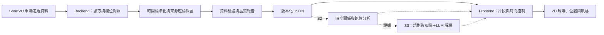

# 系統架構與分工

S1 已串接 Python 資料處理與 HTML／JavaScript／Canvas [球場回放](local-viewer.md)。
Backend 負責讀取與整理追蹤資料，Frontend 負責繪圖與互動；後續框架與部署方式由兩人共同確認。
需求依據見 [簡報整理](requirements.md)，欄位定義見 [資料交換規格](data-contract.md)。

## S1 的開發方式

Backend 先將 SportVU 的原始陣列轉為 JSON 0.2.0；Frontend 讀取此格式顯示位置與軌跡。
資料準備與使用範圍見 [資料管理](../data/README.md)。
回放介面透過僅監聽 127.0.0.1 的 Python 靜態服務讀取指定匯出；正式 API 與部署架構尚未定案。



JSON 欄位定義與傳輸方式分開，Frontend 可自行選擇符合此資料介面的技術。
S1 已透過 JSON 完成串接，執行回放不需要戰術模型或 LLM API。

## 技術與程式位置

| 範圍 | 建議 | 現況 |
| --- | --- | --- |
| Backend | Python 3.12、ijson 串流解析，pathlib 處理路徑 | 已完成首個真實事件匯出 |
| Frontend | HTML、JavaScript、Canvas，組員可另選框架 | 球場回放可讀取 0.2.0 真實匯出 |
| 資料交換 | UTF-8 JSON，含版本、單位、時間、隊伍、球與軌跡 | 已實作 0.2.0 |
| 傳輸與展示 | Python HTTP 服務提供介面與匯出的 JSON | 監聽 127.0.0.1，在啟動服務的電腦瀏覽 |
| 分析／LLM | S2／S3 才追加必要工具 | 尚未選型或安裝 |

目前使用 Canvas 繪製 2D 球場，參考
[Canvas API](https://developer.mozilla.org/en-US/docs/Web/API/Canvas_API)。
目前的程式與測試位置如下：

```text
src/basketball_tactics/
├── sportvu.py           # 單場串流讀取與來源驗證
├── backend.py           # 時間、位置、品質與軌跡匯出
├── cli.py               # 執行資料匯出的命令列入口
└── preview.py           # 提供回放介面與指定 JSON 的 HTTP 服務
tests/
├── test_environment.py
├── test_sportvu_backend.py
├── test_preview.py
└── test_viewer_model.mjs
frontend/                # HTML／CSS／JS 模組；無 build 工具
outputs/                 # Backend 自動產生的回放資料；不提交 Git
```

S2 分析與 S3 解釋模組尚未建立。資料讀取目前支援 SportVU JSON。
SportVU 已實測欄位見 [原始欄位查核](sportvu-fields.md)，其他比賽仍須確認品質。

## Backend／Frontend 責任

| 工作 | Backend：資料處理與戰術分析 | Frontend：視覺化與互動 | 共同確認 |
| --- | --- | --- | --- |
| 資料接入 | 來源盤點、讀取、原始 ID 保留、片段切分 | 顯示片段名稱與資料狀態 | 資料版本與示範片段 |
| 時間 | 保留來源順序，轉片段相對時間，重置與間隙分段 | 依實際時間播放、暫停與拖曳 | 播放與缺漏行為 |
| 座標 | 保留來源 feet，記錄單位與球場依據，不預先鏡射 | 保持比例繪製，依已核對方向轉畫面 | 原點、y 軸、場地線條與方向 |
| 身分 | 建立球員、隊伍與來源 ID 對照 | 穩定顏色、球員標籤、缺席或未知狀態 | ID 不完整時的展示方式 |
| 缺漏 | 標記缺失與軌跡中斷，輸出品質報告 | 不跨缺漏連線，顯示警告 | 可接受的展示片段 |
| 介面 | 匯出並驗證 JSON | 讀取與檢查版本，處理空值及錯誤 | schema 變更與範例 |
| S2 | 計算距離、移動、關係或模式候選及證據 | 關聯至對應球員、時間與畫面 | 特徵定義、標註與案例判讀 |
| S3 | 準備證據、知識規則、LLM 呼叫與輸出檢查 | 呈現解釋、依據與限制 | 解釋品質與錯誤案例 |
| 整合 | 重現資料匯出 | 驗證畫面與互動 | PR 審閱與展示驗收 |

Frontend 不依賴原始資料集欄位，也不自行重做單位或攻守方向推論。Backend 不將
螢幕像素當成分析座標。未提供隊伍、球位置或持球者時，兩端均保留未知狀態。

## S1 的資料交接

1. 依 [資料準備](../data/README.md) 取得指定比賽，以 SHA-256 確認兩人使用同一份原檔。
2. 依 [Backend 命令](backend-s1.md#匯出) 匯出 eventId="2"，產生片段清單與位置 JSON。
3. Frontend 讀取 teams、players、frames 與 trajectories；欄位意義見 [資料規格](data-contract.md)。
4. 兩人一起核對影格、球員、位置與軌跡，記錄畫面差異。

目前使用 Python 靜態服務連接前後端；尚未安排線上部署。
播放依 source timestamp 差建立的時間軸，不以畫面更新率或倒數 game clock 取代資料時間。
座標保留原值，不插值，也不跨缺漏連線；顯示端的方向映射待單場畫面核對後另訂。

## S2／S3 的擴充邊界

S2 延用 S1 的標準資料，先定義與人工可核對的距離、速度、移動方向及球員關係。
每個結果保存球員 ID、起訖時間、量測值與計算方法。球員接近本身不能直接當作掩護；
缺少球或攻守資訊時，不推論持球、傳球或戰術名稱。有標註後才定義類別與評估切分。

S3 接收 S2 證據與版本化的知識規則，輸出帶證據引用的解釋；LLM 不直接補造軌跡、
量測值或戰術標籤。資料不足須明示限制。API Key 由 Backend 的環境變數讀取，
不交給 Frontend。S3 服務不可用時，S1／S2 仍能展示。

S2／S3 的完整介面待各階段開始前定案，不要求 S1 提前輸出虛構分析。
