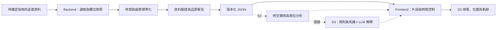

# 系統架構與分工

狀態：供討論的責任邊界，尚未建立下列功能模組。Backend 由主要開發者負責資料處理與
戰術分析，Frontend 由另一位組員負責。Frontend 尚無現成程式；HTML／JavaScript／Canvas
僅為 S1 暫定選項，框架、傳輸及部署方式由組員確認後再整合。
需求依據見 [簡報整理](requirements.md)，來源對照的資料草案見 [data-contract.md](data-contract.md)。

## S1 的開發方式

目前優先對齊 Python Backend 輸出的 JSON，讓 Frontend 不必直接理解 SportVU tuple。
SportVU 來源尚待正式採用，見 [資料評估](sportvu-assessment.md)。資料可用檔案、HTTP 或
API 傳遞，但本階段不決定整套技術架構，也不開始實作 Frontend。



JSON 欄位定義與傳輸方式分開，Frontend 可自行選擇符合此資料介面的技術。
S1 不依賴戰術模型或 LLM API；前後端確認資料規格後才安排整合。

## 技術與目錄規劃

| 範圍 | 建議 | 現況 |
| --- | --- | --- |
| Backend | Python 3.12、pandas、NumPy；使用 pathlib 處理路徑 | 已安裝，尚無功能 |
| Frontend | HTML、JavaScript、Canvas 暫定，組員可另選框架 | 尚無現成程式，本階段不實作 |
| 資料交換 | UTF-8 JSON，含版本、單位、時間、隊伍、球與軌跡 | SportVU 對照草案 0.2.0 |
| 傳輸與展示 | 檔案、HTTP 或 API | 待 Frontend 組員確認 |
| 分析／LLM | S2／S3 才追加必要工具 | 尚未選型或安裝 |

Canvas 是可選的 2D 繪圖方式，參考
[Canvas API](https://developer.mozilla.org/en-US/docs/Web/API/Canvas_API)。
下列僅為 Backend 工作包的目錄建議，按需增加；Frontend 目錄與工具待組員決定：

```text
src/basketball_tactics/
├── data_io/             # 選定資料集的讀取與匯出
├── preprocessing/       # 時間、座標、ID 對照與品質驗證
├── cli.py               # 本機匯出與展示資料準備入口
├── analysis/            # S2 才建立
└── explanation/         # S3 才建立
tests/
├── fixtures/            # 授權允許的小型樣本或明確標示的合成案例
└── ...                  # 各工作包的測試
outputs/                 # 匯出資料與分析結果；不進 Git
```

正式採用資料來源後先做一個 importer，不先設計多資料集插件系統。
SportVU 已實測欄位見 [原始欄位查核](sportvu-fields.md)，其他比賽仍須確認品質。

## Backend／Frontend 責任

| 工作 | Backend：資料處理與戰術分析 | Frontend：視覺化與互動 | 共同確認 |
| --- | --- | --- | --- |
| 資料接入 | 來源盤點、讀取、原始 ID 保留、片段切分 | 顯示片段名稱與資料狀態 | 資料版本與示範片段 |
| 時間 | 轉成片段相對時間、排序、辨識重置與間隙 | 依實際時間播放、暫停與拖曳 | 播放與缺漏行為 |
| 座標 | 保留來源 feet，記錄單位與球場依據，不預先鏡射 | 保持比例繪製，依已核對方向轉畫面 | 原點、y 軸、場地線條與方向 |
| 身分 | 建立球員、隊伍與來源 ID 對照 | 穩定顏色、球員標籤、缺席或未知狀態 | ID 不完整時的展示方式 |
| 缺漏 | 標記缺失與軌跡中斷，輸出品質報告 | 不跨缺漏連線，顯示警告 | 可接受的展示片段 |
| 介面 | 匯出並驗證 JSON | 讀取與檢查版本，處理空值及錯誤 | schema 變更與範例 |
| S2 | 計算距離、移動、關係或模式候選及證據 | 關聯至對應球員、時間與畫面 | 特徵定義、標註與案例判讀 |
| S3 | 準備證據、知識規則、LLM 呼叫與輸出檢查 | 呈現解釋、依據與限制 | 解釋品質與錯誤案例 |
| 整合 | 重現資料匯出 | 驗證畫面與互動 | PR 審閱與展示驗收 |

Frontend 不依賴原始資料集欄位，也不自行重做單位或攻守方向推論。Backend 不將
螢幕像素當成分析座標。未提供隊伍、球位置或持球者時，兩端均保留未知狀態。

## S1 的資料交接

1. 決定是否正式採用候選來源，確認課程使用與資料授權範圍，再記錄正式原檔位置。
2. Backend 保存來源、ID、時間基準及品質紀錄，選取一段可核對的短視窗。
3. 依 0.2.0 草案提供 clip 清單、球員／隊伍 metadata、逐影格位置、球與軌跡索引。
4. Frontend 組員確認技術與載入方式後，雙方再定檔案路徑或 API 介面。
5. 核對 ID、位置、時間、缺漏與軌跡連續性，完成展示驗收。

以上尚無可執行入口，server、打包與部署方式不在本階段定案。
播放依 source timestamp 差建立的時間軸，不以畫面更新率或倒數 game clock 取代資料時間。
座標保留原值，不插值，也不跨缺漏連線；顯示端的方向映射待單場畫面核對後另訂。

## S2／S3 的擴充邊界

S2 延用 S1 的標準資料，先定義與人工可核對的距離、速度、移動方向及球員關係。
每個結果保存球員 ID、起訖時間、量測值與計算方法。球員接近本身不能直接當作掩護；
缺少球或攻守資訊時，不推論持球、傳球或戰術名稱。有標註後才定義類別與評估切分。

S3 接收 S2 證據與版本化的知識規則，輸出帶證據引用的解釋；LLM 不直接補造軌跡、
量測值或戰術標籤。資料不足須明示限制。API Key 僅留在 Backend 的本機環境，
不交給 Frontend。S3 服務不可用時，S1／S2 仍能展示。

S2／S3 的完整介面待各階段開始前定案，不要求 S1 提前輸出虛構分析。
